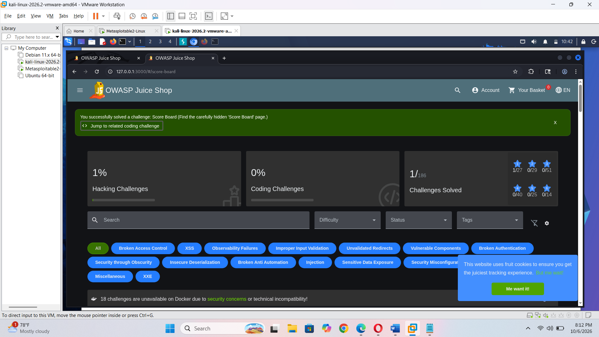
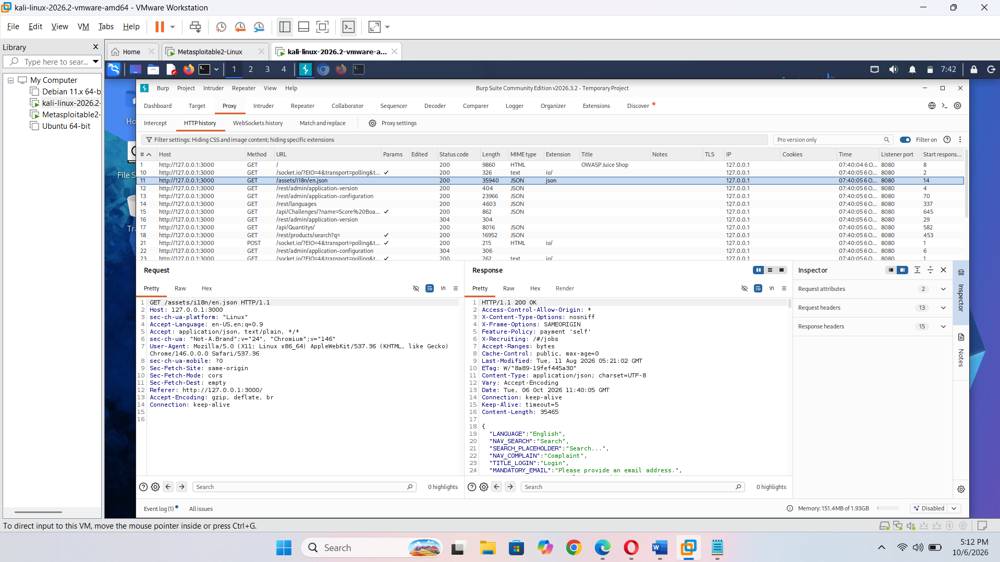
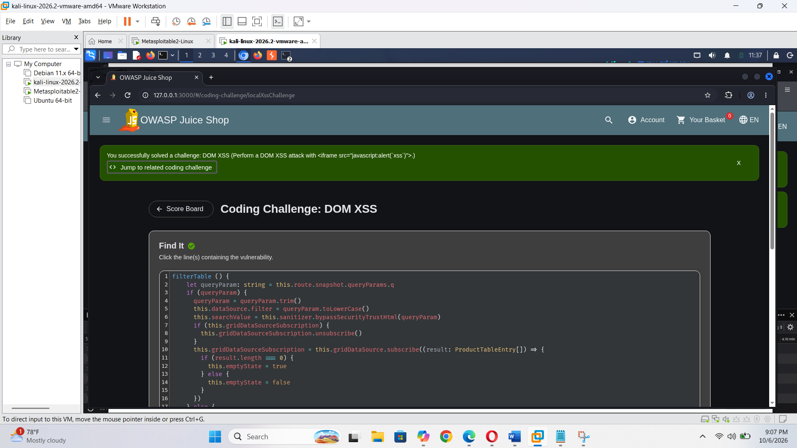

# OWASP Juice Shop – Web Application Security Assessment

## Project Overview

This project documents a hands-on web application security assessment using OWASP Juice Shop, an intentionally vulnerable application designed for security training and practice.

The assessment involved exploring application functionality, analysing HTTP traffic, reviewing the application site map, and completing five practical security challenge scenarios.

## Objectives

- Understand the basic workflow of a web application security assessment.
- Analyse HTTP requests and responses.
- Explore application routes and functionality.
- Practise selected web application security testing scenarios.
- Document completed activities with screenshot evidence.

## Tools and Technologies

- OWASP Juice Shop
- Burp Suite
- Web Browser

## Completed Challenge Scenarios

The following five scenarios were completed:

1. DOM-Based Cross-Site Scripting (DOM XSS)
2. Login Admin
3. Admin Section
4. Zero Stars
5. View Basket

## Activities Performed

- Explored the OWASP Juice Shop application.
- Reviewed baseline network activity.
- Inspected HTTP history using Burp Suite.
- Examined the application's site map.
- Reviewed login-related HTTP requests.
- Completed and documented selected practice challenges.
- Captured screenshots as evidence of the assessment activities.

## Evidence

The `screenshots` folder contains 11 screenshots documenting the application exploration, traffic analysis, and completed challenge scenarios.

## Key Learning Outcomes

- Better understanding of web application security testing.
- Practical experience using Burp Suite.
- Understanding HTTP request and response analysis.
- Familiarity with application site mapping and navigation.
- Improved ability to document technical security testing activities.

## Scope and Ethics

This project was conducted for educational purposes using OWASP Juice Shop in a controlled practice environment. Security testing should only be performed on systems where proper authorization has been granted.

## Project Status

Completed – Five practical challenge scenarios documented.

## Full Project Report

[View OWASP Juice Shop Security Assessment Report (PDF)](report/OWASP-Juice-Shop-Security-Assessment.pdf)

## Project Evidence

### Juice Shop Scoreboard

### Burp Suite HTTP History

### DOM XSS Challenge

